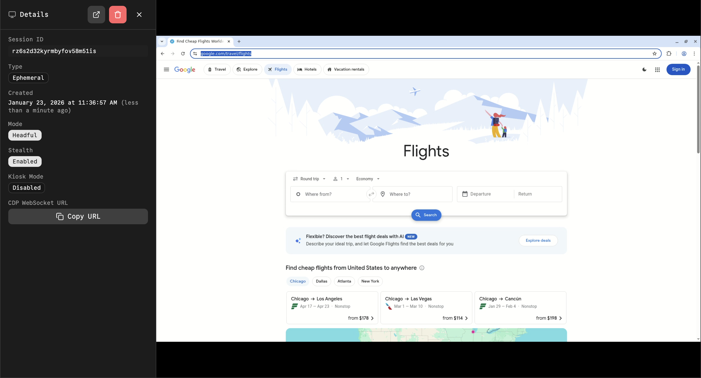
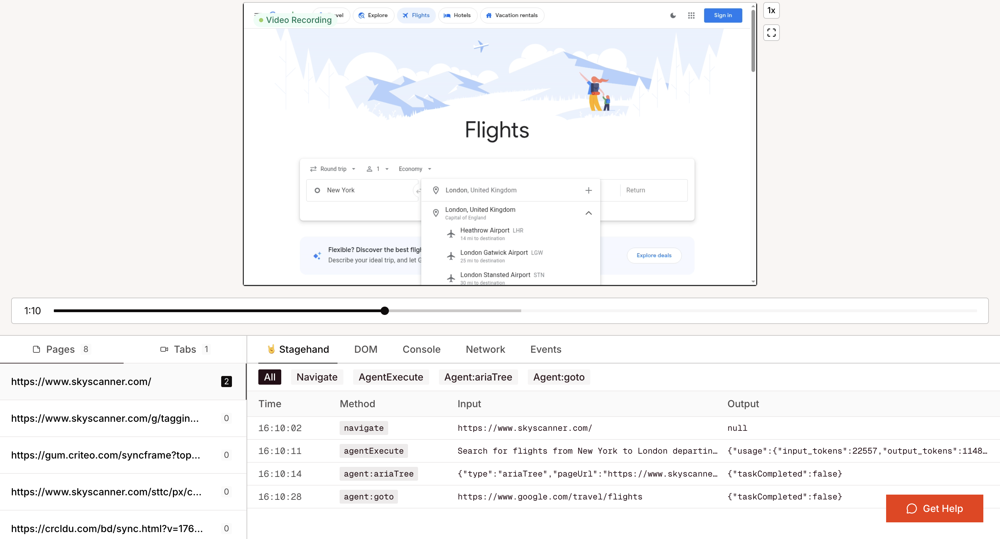
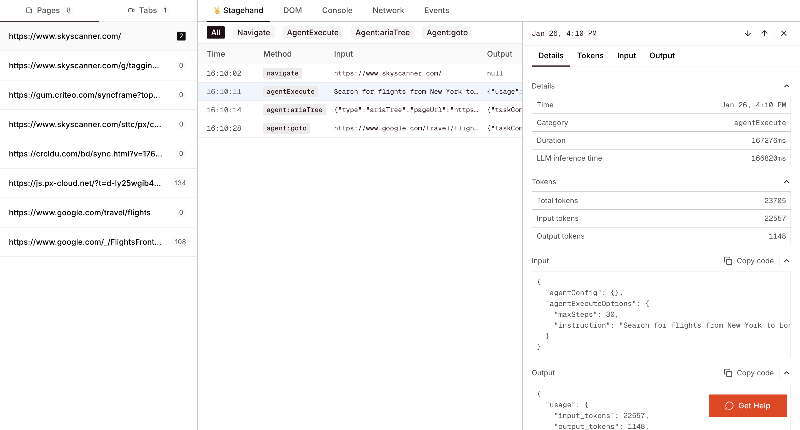
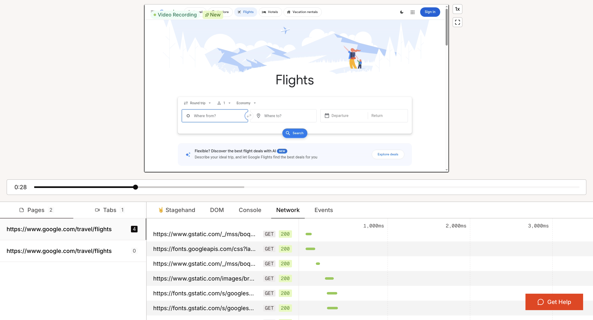
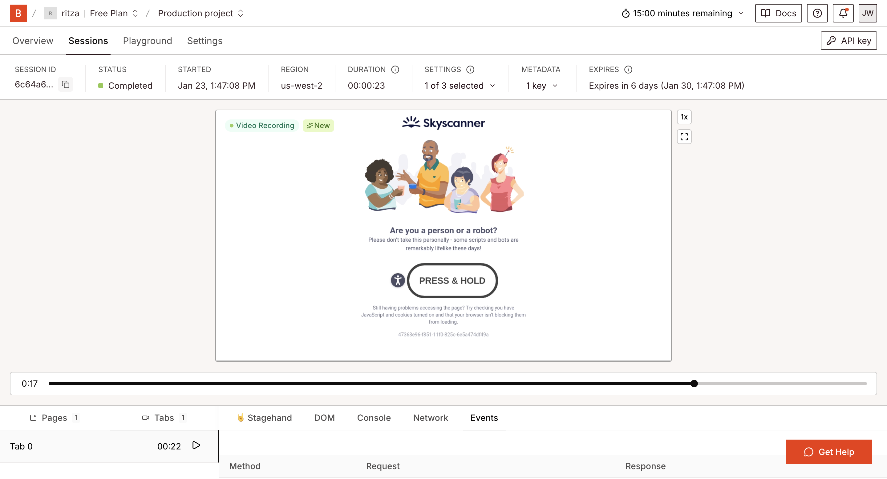

---
hide:
  - navigation
---

# Browserbase vs Kernel: Cloud Browser Automation for AI Agents

I built an automated travel agent that searches Google Flights and extracts the cheapest flights. Give it a query like "New York to London, January 30 - February 6" and it returns structured flight data:

<video src="/articles/assets/browserbase-vs-kernel/example-for-intro.mp4" controls></video>

[See the code on GitHub](https://github.com/jamesdanielwhitford/kernel-flight-tracker)

This guide compares Browserbase and Kernel—the two remote browser platforms I used to build it. I'll show how they work, how AI agents control them, and their practical differences when handling real sites like Google Flights and Skyscanner.

## How AI Agents Access Browsers

Claude Code runs on your machine. It makes API calls and executes local bash commands. It can read files, write code, and run scripts.

It can't currently use a browser like a human does or interact with JavaScript-heavy sites with its default configuration. When you ask Claude Code to fetch Google Flights, it makes an HTTP request. The request returns an empty shell because the content loads dynamically with JavaScript.

### Hybrid Approach: Local Browser with Remote AI

Tools like [dev-browser](https://github.com/SawyerHood/dev-browser) solve this by launching Chrome on your machine and connecting the remote AI to it using the Chrome DevTools Protocol (CDP). The browser runs locally. The AI runs on remote servers (Anthropic, OpenAI, etc.). The AI sees your browser's DOM, sends commands to click elements, fill forms, and extract data.

This works for personal projects. The browser has your logged-in sessions and cookies. The AI can interact with authenticated sites. The limitation is scale—running multiple Chrome instances consumes significant memory, browser crashes need manual cleanup, and you're constrained by your machine's resources.

### Remote Browsers with Remote AI: Everything in the Cloud

Browserbase and Kernel run Chrome instances in the cloud. Both the browser and the AI controlling it run on remote servers.

You request a browser via their API. They start Chrome in a VM and return a WebSocket URL. You connect an automation library (I used Stagehand) to that URL. Your code runs on your machine, but it orchestrates remote resources.

Here's how the data flows: Stagehand fetches the page DOM from the remote browser. It sends that DOM to an LLM API you specify—I used GPT-5 with my OpenAI API key. The LLM returns element selectors or actions (click button #42, type "London" into input field #7). Stagehand sends those CDP commands over the WebSocket to the remote browser. The browser executes them.

The cloud service manages browser resources (memory, crashes, updates). You write instructions like "search for flights to London." The LLM figures out how to execute those instructions by analyzing the page structure. You pay for browser sessions plus LLM API calls.

This guide focuses on remote browsers because that's what scales beyond personal projects.

## Spinning Up Remote Browsers

A remote browser is a Chrome instance running in a virtual machine. You request one from Browserbase or Kernel through their API. They start Chrome and return a connection URL. Your automation code connects to that URL and controls the remote browser.

Remote browsers handle infrastructure (persistent sessions, automatic updates, container isolation) and provide observability tools (video recording, logs, network inspection) that would be difficult to build yourself.

You use them when scaling beyond local Chrome instances, when debugging production automation failures, or when building AI agents where both the model and browser run remotely.

Both Browserbase and Kernel provide cloud Chrome browsers. Kernel prioritizes speed and minimal overhead. Browserbase prioritizes observability and debugging tools.

### Creating a Browser on Kernel

Kernel's SDK creates a browser and returns a WebSocket URL. You connect using Playwright's Chrome DevTools Protocol (CDP):

```javascript
import Kernel from '@onkernel/sdk';
import { chromium } from 'playwright';

const kernel = new Kernel({
  apiKey: process.env.KERNEL_API_KEY
});

const startTime = performance.now();
const kernelBrowser = await kernel.browsers.create();
const createTime = performance.now() - startTime;

const connectStart = performance.now();
const browser = await chromium.connectOverCDP(kernelBrowser.cdp_ws_url);
const connectTime = performance.now() - connectStart;

const context = browser.contexts()[0];
const page = context.pages()[0];

const navStart = performance.now();
await page.goto('https://www.skyscanner.com/');
const navTime = performance.now() - navStart;

console.log('Browser creation:', (createTime / 1000).toFixed(2) + 's');
console.log('CDP connection:', (connectTime / 1000).toFixed(2) + 's');
console.log('Page navigation:', (navTime / 1000).toFixed(2) + 's');
console.log('Live View:', kernelBrowser.browser_live_view_url);
```

I wrapped each operation in `performance.now()` calls to measure execution time. Running this produces:

```
Browser creation: 0.94s
CDP connection:   1.98s
Page navigation:  1.50s
Total:            4.42s

Session ID: q60fa1i7zpfzvd99gslqjzru
Live View:  https://proxy.iad-pedantic-rhodes.onkernel.com:8443/browser/live/ZsDmmTN8K5Fl
```

The live view URL shows the remote browser in real-time:



Kernel's Live View streams the browser screen while automation runs. You can interact with the session through this view—clicking or typing affects the running browser. This helps when debugging agents that take unexpected actions or get stuck.

The live view expires when the session ends. Kernel's free tier doesn't save recordings. The paid tier offers manual video recording through `startRecording()` and `stopRecording()` API calls.

### Creating a Session on Browserbase

Browserbase works similarly. I added the same timing measurements:

```javascript
const { chromium } = require('playwright-core');
const Browserbase = require('@browserbasehq/sdk').default;

const bb = new Browserbase({
  apiKey: process.env.BROWSERBASE_API_KEY
});

const startTime = performance.now();
const session = await bb.sessions.create({
  projectId: process.env.BROWSERBASE_PROJECT_ID
});
const createTime = performance.now() - startTime;

const connectStart = performance.now();
const browser = await chromium.connectOverCDP(session.connectUrl);
const connectTime = performance.now() - connectStart;

const defaultContext = browser.contexts()[0];
const page = defaultContext.pages()[0];

const navStart = performance.now();
await page.goto('https://www.skyscanner.com/');
const navTime = performance.now() - navStart;

console.log('Session creation:', (createTime / 1000).toFixed(2) + 's');
console.log('CDP connection:', (connectTime / 1000).toFixed(2) + 's');
console.log('Page navigation:', (navTime / 1000).toFixed(2) + 's');
console.log('Session replay:', `https://browserbase.com/sessions/${session.id}`);
```

Running this produces:

```
Session creation:  2.14s
CDP connection:    2.60s
Page navigation:   5.69s
Total time:        11.44s

Session ID: a620443e-b942-4920-a64d-a217888046ec
Session replay: https://browserbase.com/sessions/a620443e-b942-4920-a64d-a217888046ec
```

The session replay URL remains accessible after the session ends, unlike Kernel's live view:



Browserbase automatically records every session. The video becomes available about 30 seconds after the session ends. The dashboard includes Console (errors and logs), Network (HTTP requests with timing), DOM (page structure inspection), and Stagehand (token usage and extraction results) tabs. Sessions persist according to your plan's retention policy, so you can share URLs with teammates or review historical failures.

### Speed Comparison

| Step | Kernel | Browserbase |
|------|--------|-------------|
| Browser/session creation | 0.94s | 2.14s |
| CDP connection | 1.98s | 2.60s |
| Page navigation | 1.50s | 5.69s |
| **Total** | **4.42s** | **11.44s** |

Kernel spins up a browser 2.6x faster. Browserbase's recording infrastructure (video, logs, network capture) adds latency at session creation and during page navigation. Kernel provides a bare browser without automatic recording.

---

## Giving Agent Access to Browser

Raw Chrome DevTools Protocol automation breaks when sites redesign their forms. You write `await page.click('button[data-testid="search-button"]')`. The site changes `data-testid` to `data-qa-id`. Your automation stops working.

Stagehand adds an AI layer that uses natural language instructions instead of CSS selectors. You provide an LLM API key (OpenAI, Anthropic, or Google). Stagehand sends page structure to the LLM, receives element selectors or action coordinates, then executes those actions through Playwright.

The same Stagehand code runs on Kernel, Browserbase, or local browsers—only the connection setup changes.

### Running an Agent on Kernel

Kernel provides a CDP WebSocket URL when you create a browser. Pass that URL to Stagehand's local browser options:

```javascript
import Kernel from '@onkernel/sdk';
import { Stagehand } from '@browserbasehq/stagehand';

const kernel = new Kernel({
  apiKey: process.env.KERNEL_API_KEY
});

const kernelBrowser = await kernel.browsers.create();

const stagehand = new Stagehand({
  env: 'LOCAL',
  localBrowserLaunchOptions: {
    cdpUrl: kernelBrowser.cdp_ws_url,
  },
  model: 'openai/gpt-5',
});

await stagehand.init();
const page = stagehand.context.pages()[0];
```

Stagehand's `agent()` method handles multi-step workflows autonomously. I built a flight search that navigates to Google Flights and fills the search form:

```javascript
const startTime = performance.now();

await page.goto('https://www.google.com/travel/flights');

const agent = stagehand.agent();
await agent.execute({
  instruction: 'Search for flights from New York to London departing January 30th and returning February 6th',
  maxSteps: 30,
});

const agentTime = performance.now() - startTime;
console.log('Agent execution:', (agentTime / 1000).toFixed(2) + 's');
```

The agent autonomously fills departure/destination cities, selects dates from the picker, clicks Search, and waits for results. Google Flights required about 20 steps to complete. The `maxSteps: 30` parameter provides buffer room (the default is 20).

I added timing measurements to see how long the autonomous workflow takes. Running this produces:

```
Agent execution: 620.45s  (10 minutes 20 seconds)
```

After the agent completes, the page shows flight results. Stagehand's `extract()` method parses page content into structured data using Zod schemas:

```javascript
import { z } from 'zod';

const flightSchema = z.array(
  z.object({
    airline: z.string(),
    price: z.string(),
    departureTime: z.string(),
  })
);

const extractStart = performance.now();
const flights = await stagehand.extract(
  'Extract the first 3 flight options with airline, price, and departure time',
  flightSchema
);
const extractTime = performance.now() - extractStart;

console.log('Extraction time:', (extractTime / 1000).toFixed(2) + 's');
console.log(flights);
```

The LLM identifies which parts of the page match the schema and returns JSON:

```
Extraction time: 40.12s

[
  {
    "airline": "Norse Atlantic UK",
    "price": "$385",
    "departureTime": "6:05 PM"
  },
  {
    "airline": "Delta",
    "price": "$519",
    "departureTime": "8:00 PM"
  },
  {
    "airline": "JetBlue",
    "price": "$524",
    "departureTime": "8:45 AM"
  }
]
```

Total workflow time: 620.45s (agent) + 40.12s (extraction) = ~11 minutes using GPT-5.

Kernel's Live View lets you watch the agent work in real-time (video shown at 2x speed):

<video src="/articles/assets/browserbase-vs-kernel/kernel-agent-live-view.mp4" controls></video>

### Running an Agent on Browserbase

Browserbase integration is simpler because Stagehand handles session creation automatically:

```javascript
import { Stagehand } from '@browserbasehq/stagehand';

const stagehand = new Stagehand({
  env: 'BROWSERBASE',
  apiKey: process.env.BROWSERBASE_API_KEY,
  projectId: process.env.BROWSERBASE_PROJECT_ID,
  model: 'openai/gpt-5',
});

await stagehand.init();
const page = stagehand.context.pages()[0];
```

The agent and extraction code is identical to Kernel. The same flight search task produced identical results.

Browserbase's Session Inspector automatically recorded the entire workflow. The Session Inspector includes a Stagehand tab showing token usage, timing, Zod schemas, and extraction results:



---

## Debugging When Things Break

Browser automation fails at different layers: the browser crashes, the agent clicks the wrong element, Stagehand times out, or the LLM generates an invalid selector. Each layer needs different debugging tools.

Stagehand provides application-level debugging (logs, LLM inference files) that works on both platforms. Kernel and Browserbase each provide infrastructure-level debugging (video, console logs, network inspection) with different trade-offs.

### Debugging with Stagehand

I added verbose logging to see what the agent was doing:

```javascript
const stagehand = new Stagehand({
  env: 'LOCAL',
  verbose: 2,  // 0=errors, 1=info, 2=debug
  logInferenceToFile: true,  // Saves LLM request/response to disk
});
```

This produces logs showing which elements Stagehand identified and which XPaths it executed:

```
[INFO] Agent calling tool: act | arguments=type "New York" into the Where from? combobox
[INFO] response | elementId=16-23, method=type, arguments=["New York"]
[DEBUG] final tail | xpath=/html[1]/body[1]/c-wiz[2]/div[1]/.../input[1]
[INFO] action complete
```

The `logInferenceToFile: true` setting saves the complete LLM request and response for every action to `./inference_summary/`. The `act_call.txt` file contains the entire DOM snapshot sent to the LLM. The `act_response.txt` shows which element the LLM selected and why. When Stagehand clicks the wrong element, these files reveal whether the DOM was stale or whether multiple elements matched the instruction.

### Debugging with Kernel

Kernel provides a live view URL showing the browser screen in real-time:

```javascript
const browser = await kernel.browsers.create();
console.log('Live View:', browser.browser_live_view_url);
```

I opened the live view URL in another tab while the agent ran. I watched it type into fields, open dropdowns, and select dates:

<video src="/articles/assets/browserbase-vs-kernel/kernel-live-view-session.mp4" controls></video>

The live view URL expires when the session ends. Kernel's free tier doesn't save video recordings. Paid plans add manual video recording through `replays.start()` and `replays.stop()` API calls. Videos download as MP4 files.

### Debugging with Browserbase

Browserbase records every session automatically:

```javascript
const stagehand = new Stagehand({
  env: 'BROWSERBASE',
  apiKey: process.env.BROWSERBASE_API_KEY,
  projectId: process.env.BROWSERBASE_PROJECT_ID,
});

await stagehand.init();
const sessionId = stagehand.browserbaseSessionID;
console.log(`Session Inspector: https://browserbase.com/sessions/${sessionId}`);
```

The Session Inspector URL works during and after the session. Video becomes available about 30 seconds after the session ends:



The dashboard includes Console (browser logs), Network (HTTP requests/responses), and Stagehand tabs. The Stagehand tab breaks down token consumption and timing per operation.

Browserbase's Session Inspector is free and automatic. Kernel's free tier requires watching live—you can't replay sessions after they end.

## Handling Bot Detection

I tested both platforms against Skyscanner to see how they handle bot detection. Skyscanner uses a "Press & Hold" verification challenge to block automated browsers.

### Testing Without Stealth

Both Kernel (without stealth mode) and Browserbase (free tier) hit the same bot detection screen immediately:



### Testing Kernel's Stealth Mode

Kernel's free tier includes stealth mode:

```javascript
const browser = await kernel.browsers.create({
  stealth: true,
});
```

The `stealth: true` flag enables residential proxy routing, browser fingerprint randomization, and headful mode (harder to detect than headless).

With stealth enabled, Skyscanner's initial page loaded without showing the bot detection screen. The agent filled the flight search form successfully. When the agent clicked Search, Skyscanner showed the bot detection challenge again. The agent couldn't bypass it.

The agent abandoned Skyscanner and navigated to Google Flights instead. It completed the flight search there and returned results (video shown at 4x speed):

<video src="/articles/assets/browserbase-vs-kernel/kernel-agent-abandons-skyscanner.mp4" controls></video>

```
[
  { "airline": "Norse Atlantic UK", "price": "$385", "departureTime": "6:05 PM" },
  { "airline": "Delta", "price": "$519", "departureTime": "8:00 PM" },
  { "airline": "JetBlue", "price": "$524", "departureTime": "8:45 AM" }
]
```

I gave the agent this instruction: "Search for flights from New York to London departing January 30th and returning February 6th on Skyscanner." It ignored the Skyscanner requirement when it hit the bot detection screen.

### Agent Behavior: Unpredictable or Resourceful?

Both platforms showed the same pattern. The agents encountered bot detection on Skyscanner. Instead of failing or reporting an error, they switched sites autonomously and completed the task.

This raises a question about autonomous agents: They fulfilled the core requirement (finding flights) but ignored explicit instructions (use Skyscanner). You could view this as resourceful problem-solving or as unpredictable behavior that deviates from instructions.

### Browserbase Stealth Options

Browserbase's free tier has no stealth features. Paid plans add:

**Basic Stealth Mode** (Developer plan): Activates automatically, randomizes fingerprints and viewport sizes per session.

**Advanced Stealth Mode** (Scale plan): Custom Chromium build. Requires manual session creation, which conflicts with Stagehand's automatic session management.

**Proxies** (Developer+ plans): Residential IP routing. Developer plan includes 1GB bandwidth.

I couldn't test paid features without a subscription.

### Stealth Mode Limitations

Kernel's stealth mode (free) bypassed Skyscanner's initial bot detection but failed when the agent tried to search. Both platforms ultimately succeeded by switching to Google Flights, which didn't show bot detection screens.

Stealth features help but don't guarantee bypass. Sites like Skyscanner actively detect automation even with residential proxies and fingerprint randomization.

---

## Conclusion

Both platforms give AI agents access to real web pages. They run Chrome in VMs and provide WebSocket connections your code controls remotely.

Browserbase automatically records every session with video, console logs, and network inspection. When my agent behaved unexpectedly, I replayed the session to see exactly what it did. 

Kernel spins up browsers faster—4.42 seconds versus Browserbase's 11.44 seconds. The free tier includes stealth mode with residential proxies.

Stagehand made switching platforms straightforward. The same automation code ran on both. I changed connection parameters and everything worked identically.

Bot detection was harder to solve. Kernel's stealth mode bypassed Skyscanner's initial detection but failed when the agent tried to search. Both agents autonomously switched to Google Flights to complete the task. They fulfilled the goal but ignored explicit instructions about which site to use.

Test against your actual target sites early. Stealth features help but don't guarantee bypass. Agent behavior becomes unpredictable when they encounter obstacles you didn't anticipate.
